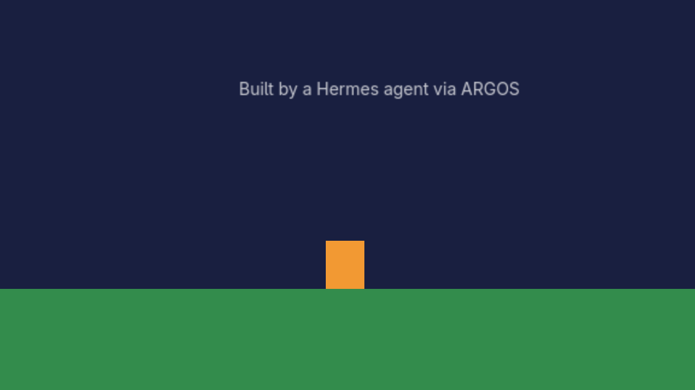
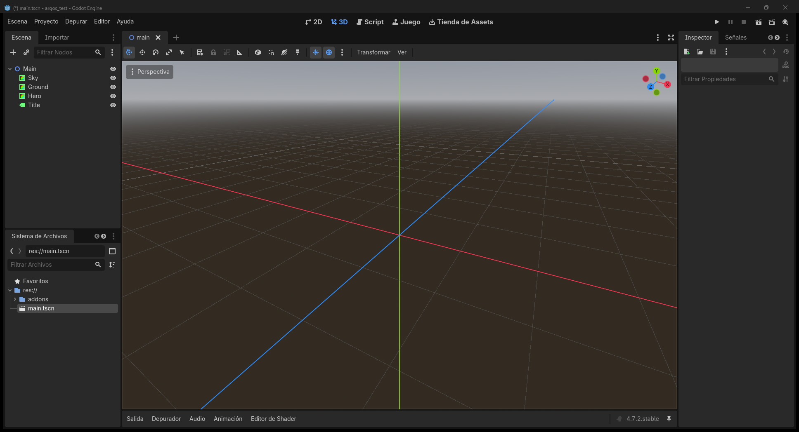

# ARGOS - Hermes ⇄ Godot 4 editor portal

**English** · [Español](#español)

ARGOS lets a Hermes agent work inside a **live Godot 4 editor**: read the scene tree, create / move / delete nodes, change properties with the editor's **real undo**, open and save scenes, play and stop the game, validate GDScript and take screenshots. The Godot addon *is* the server (a local WebSocket on `127.0.0.1`), and `tools/argos_mcp.py` exposes it to Hermes as an MCP server with **27 tools**.




## Requirements

- **Godot 4.x** (tested on 4.7.2)
- **Python 3.11+** with `websockets` (`pip install -r requirements.txt`)
- Hermes **0.21.5** or newer

## Install in Hermes

From the catalog (once listed): `hermes plugins install argos`

Or by hand, in `config.yaml` (per profile):

```yaml
mcp_servers:
  argos:
    command: python            # a Python that has `websockets`
    args:
      - /path/to/argos/tools/argos_mcp.py
    env:
      ARGOS_PROJECT: /path/to/your/godot/project   # optional default project
    enabled: true
```

Then add the addon to your Godot project:

```bash
python tools/argos_install.py --project /path/to/your/godot/project
```

Open the project in Godot (or let the agent run `argos_editor_launch`) and check with `argos_ping`.

## How editing works

- Every tool accepts `project`; if omitted, `ARGOS_PROJECT` is used.
- `argos_editor_launch`, `argos_check` and `argos_run_play` refuse a project that is not `ARGOS_PROJECT` or listed in `ARGOS_ALLOWED_PROJECTS` (`os.pathsep`-separated). Opening a project runs its editor plugins and `@tool` scripts.
- Node and scene tools need an open scene. If none is open, ARGOS opens `scene_path` (if you pass one) or the project's main scene, and retries. If there is neither, it returns a clear `no_scene` error telling you what to do.
- All edits land in the editor's undo history (`argos_undo` / `argos_redo`).

## What it does on your machine (disclosure)

- Opens a WebSocket **only on 127.0.0.1** (ports 9080+), protected by a CSPRNG token (`Crypto.generate_random_bytes`) rotated every editor start, stored in `<project>/.argos/`.
- Writes state and history under `<project>/.argos/`. Screenshots may only be written to `<project>/.argos/captures/` or `res://` (no absolute paths, no `..`, and existing files are not overwritten).
- Runs shell commands: launches the Godot editor, `godot --check-only` for script checks, and plays your scenes, which **executes the project's own GDScript**. Launch, check and play stay inside the project allowlist. Use it on projects you trust.
- Editor start/stop works on Windows, Linux and macOS. Set `ARGOS_GODOT` to the editor binary, or leave it unset to use `godot` on `PATH` (on Windows the historical default install path is still the fallback).
- No network calls to third parties, no telemetry, no credentials, no self-update.
- `argos_raw` is an escape hatch that sends any ARGOS action; treat it like the other editing tools.

## Tests

```bash
pip install -r requirements.txt pytest
python -m pytest tools -q          # 162 tests, no Godot needed
python tools/argos_mcp_selftest.py <project> --require-editor   # live, editor open
```

License: MIT © Tormen28

---

## Español

ARGOS permite que un agente de Hermes trabaje dentro de un **editor de Godot 4 abierto**: leer el árbol de escena, crear / mover / borrar nodos, cambiar propiedades con el **deshacer real** del editor, abrir y guardar escenas, ejecutar y detener el juego, validar GDScript y sacar capturas. El addon de Godot *es* el servidor (WebSocket local en `127.0.0.1`), y `tools/argos_mcp.py` lo expone a Hermes como servidor MCP con **27 herramientas**.

### Requisitos

- **Godot 4.x** (probado en 4.7.2)
- **Python 3.11+** con `websockets` (`pip install -r requirements.txt`)
- Hermes **0.21.5** o más nuevo

### Instalar en Hermes

Desde el catálogo (cuando esté publicado): `hermes plugins install argos`

O a mano, en `config.yaml` (por perfil):

```yaml
mcp_servers:
  argos:
    command: python            # un Python que tenga `websockets`
    args:
      - /ruta/a/argos/tools/argos_mcp.py
    env:
      ARGOS_PROJECT: /ruta/a/tu/proyecto/godot   # proyecto por defecto (opcional)
    enabled: true
```

Después instala el addon en tu proyecto de Godot:

```bash
python tools/argos_install.py --project /ruta/a/tu/proyecto/godot
```

Abre el proyecto en Godot (o deja que el agente use `argos_editor_launch`) y comprueba con `argos_ping`.

### Cómo funciona la edición

- Todas las herramientas aceptan `project`; si no se pasa, se usa `ARGOS_PROJECT`.
- `argos_editor_launch`, `argos_check` y `argos_run_play` rechazan un proyecto que no sea `ARGOS_PROJECT` ni esté en `ARGOS_ALLOWED_PROJECTS` (separado por `os.pathsep`). Abrir un proyecto ejecuta sus plugins de editor y sus scripts `@tool`.
- Las herramientas de nodos y escenas necesitan una escena abierta. Si no hay ninguna, ARGOS abre `scene_path` (si lo pasas) o la escena principal del proyecto y reintenta. Si no hay ninguna de las dos, devuelve un error `no_scene` claro que dice qué hacer.
- Todos los cambios quedan en el historial de deshacer del editor (`argos_undo` / `argos_redo`).

### Qué hace en tu equipo

- Abre un WebSocket **solo en 127.0.0.1** (puertos 9080+), protegido con un token CSPRNG (`Crypto.generate_random_bytes`) que cambia en cada arranque del editor y se guarda en `<proyecto>/.argos/`.
- Escribe estado e historial en `<proyecto>/.argos/`. Las capturas solo pueden ir a `<proyecto>/.argos/captures/` o `res://` (sin rutas absolutas, sin `..` y sin pisar un archivo que ya existe).
- Ejecuta comandos: abre el editor de Godot, `godot --check-only` para validar scripts y ejecuta tus escenas, lo que **corre el GDScript del propio proyecto**. Launch, check y play se quedan en la lista de proyectos permitidos. Úsalo con proyectos de confianza.
- Arrancar y detener el editor funciona en Windows, Linux y macOS. Define `ARGOS_GODOT` con el binario, o déjalo vacío para usar `godot` en el `PATH` (en Windows, si no está definido, se sigue usando la ruta de instalación histórica).
- Sin llamadas a terceros, sin telemetría, sin credenciales y sin autoactualización.
- `argos_raw` es una vía directa para enviar cualquier acción ARGOS; trátala como las demás herramientas de edición.

### Pruebas

```bash
pip install -r requirements.txt pytest
python -m pytest tools -q          # 162 pruebas, sin Godot
python tools/argos_mcp_selftest.py <proyecto> --require-editor   # en vivo, con el editor abierto
```

Licencia: MIT © Tormen28
